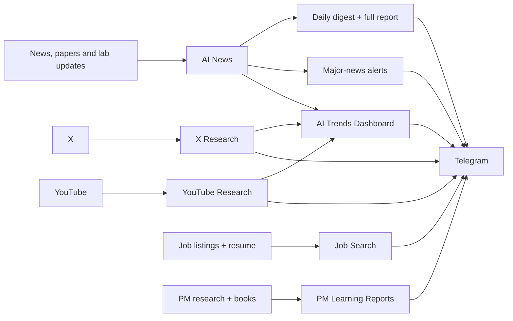

# Self-Hosted AI Research & Automation on NVIDIA DGX Spark

AI personal research system built on NVIDIA DGX Spark using Hermes mainly, with Telegram as the interface. I also experimented with OpenClaw.

I built this system to keep up with AI without checking every source individually:  **AI development moves fast across X, YouTube, research papers, frontier lab posts, and independence blogs.** this allowed for me to stop spending hours looking for this information and dig into whatever interested me. 

The system separates the collection, research, synthesis, and delivery into different workflows. It supports scheduled briefs, selective alerts, cross-agent trend synthesis.

Second, I built an additional agent to help with keeping up with the latest product management trends and news. This agent aggregates information such as book recommendation, new concepts, and trends across product management. I also built a job-search agent that recommends roles based on the specific things I am looking for. 


## Why I built it

First, I know it is a struggle to keep up with AI news. Even people in the field have to be vigilant about looking through multiple forms of media to figure out what is going on. I wanted a system that helped me understand:

- What is going on?
- What actually changed?
- Why does it matter?
- Have I already seen this story?
- Does it warrant an interruption, a daily summary, or deeper reading?
  

## Agents

| Agent | Responsibility |
|---|---|
| **AI News** | Collects news, model releases, benchmark updates into daily Telegram digest and full report with separate major news alert and Todoist reading tasks. |
| **X Research** | Looks into significant AI discussions on X, checks original claims against supporting evidence, and delivers briefs. |
| **YouTube Research** | Monitors 500 channels, selects 10 recent videos for transcript based review, and delivers timestamped summaries with evidence checks, caveats, and takeaways. |
| **AI Trends Dashboard** | Reads the other research bots' completed work, merges overlapping stories, and updates a persistent dashboard when meaningful trends or evidence changes. |
| **Job Search** | Finds senior product roles, verifies openings, and evaluates fit against a privately supplied resume. |
| **Product Management Reports** | Finds PM practices, foundations, and books throughout the week, then produces weekly leaning edition with examples and sources. |

## Architecture



Agents run independently through Hermes on the DGX. The dashboard synthesizes their completed AI research. AI News and X also maintain Todoist reading lists.


**Hosting:** NVIDIA DGX Spark  
**Agent framework:** Hermes  
**Interface:** Telegram  
**Inference:** Local models include MiniMax-M2.7 (UD-IQ4_XS via llama.cpp), Qwen3 30B-A3B, and Qwen3.5 27B (Q4_K_M and Q8_0 via Ollama). The exported primary agent configurations currently use cloud Codex.
**Automation:** Hermes scheduled jobs and Linux services

Self-hosting the agents does not mean every inference request stays on-device. Provider choice determines where model processing occurs.


## What I built

I used Hermes to build and run these agents on my DGX Spark, I chose what each agent should cover, which sources to use, how to check the information, and when to send me updates through telegram. 

I used AI-assisted coding to develop and adapt the scripts for collecting information, reviewing transcripts, checking outputs, and delivering reports. I also configured the models and schedules and worked through issues like repeated news, missed updates, and model usage limits.


## Repository structure

```text
agents/
├── ai-news/
├── x-research/
├── youtube-research/
├── ai-trends-dashboard/
├── job-search/
├── orchestrator/
└── product-management-reports/

EXPORT-NOTES.txt
.gitignore
```

Each agent folder contains its instructions, configuration examples, schedule templates, and available implementation files. Custom scripts, tests, and deployment examples are included where applicable.

The product-management folder also contains exported report-building code and templates.

## Current status

**This repository is a sanitized export of an existing deployment, not yet a turnkey installation.**

- Schedule examples are disabled by default.
- Credentials, personal identifiers, conversations, memories, resumes, and runtime databases are excluded.
- Paths, recipients, provider access, and upstream job references require configuration.
- Some workflows depend on generated artifacts or installed Hermes components not included here.
- The exported files received syntax and sanitization checks; the full exported system has not yet been validated end to end.
- The orchestrator contains routing instructions that need reconciliation.

See [EXPORT-NOTES.txt](EXPORT-NOTES.txt) for the current dependency and review notes.

## Lessons from operating the system

**More agents do not automatically produce better results.** Clear responsibilities, useful handoffs, and verification matter more than agent count.

**Collection is not understanding.** Source volume needs editorial selection and evidence checking before it becomes useful intelligence.

**Generation is not delivery.** A report existing on disk does not prove the user received it.

**Errors need actionable explanations.** Authentication failures, exhausted model allowance, failed sources, and delivery failures require different responses.

**Quiet behavior is a product feature.** An unchanged state should not create another notification.

