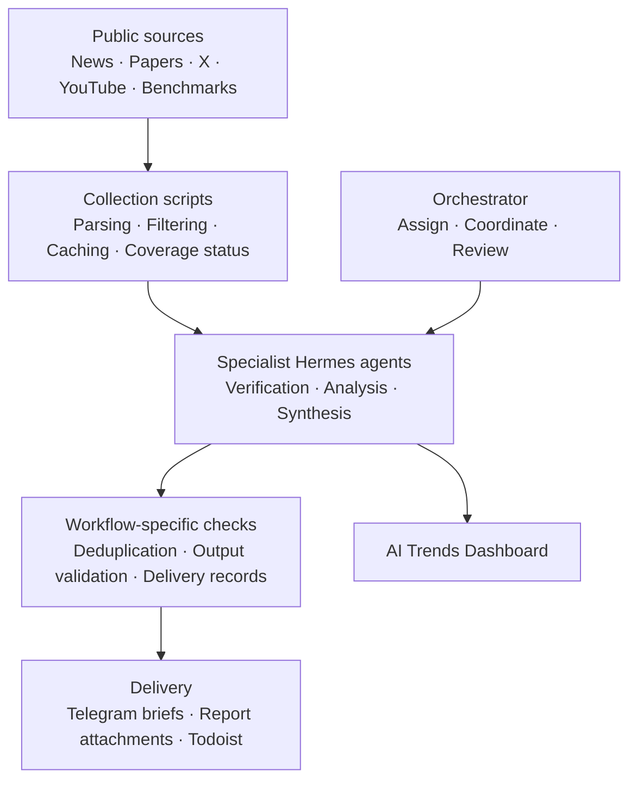

# Self-Hosted AI Research & Automation on NVIDIA DGX Spark

AI research system built on NVIDIA DGX Spark using Hermes, specialized agents, and Telegram interfaces.

I designed this system to solve a recurring problem: **keeping up with AI developments across news, research, X, and YouTube without spending hours collecting, filtering, and reading overlapping information.**

The system separates source collection, research, synthesis, and delivery into specialized workflows. It supports scheduled briefs, selective alerts, cross-agent trend synthesis, job discovery, and product-management learning.

## Why I built it

Most information feeds optimize for volume. I wanted a system that helped me understand:

- What actually changed?
- Is the claim supported by primary evidence?
- Why does it matter?
- Have I already seen this story?
- Does it warrant an interruption, a daily summary, or deeper reading?

This project explores those questions through a working deployment, with explicit editorial instructions, deterministic collection scripts, persistent state, and automated delivery.

## Agents

| Agent | Responsibility |
|---|---|
| **AI News** | Collects developments, produces daily intelligence reports, and monitors for major updates. |
| **X Research** | Discovers emerging AI discussions and verifies consequential claims against primary sources. |
| **YouTube Research** | Selects videos, retrieves transcripts, produces structured reviews, and checks brief quality. |
| **AI Trends Dashboard** | Synthesizes completed research across profiles into trends, implications, and watchlists. |
| **Job Search** | Finds senior product roles, verifies openings, and evaluates fit against a privately supplied resume. |
| **Product Management Reports** | Develops evidence-backed learning material and supports a weekly publication workflow. |
| **Orchestrator** | Coordinates specialist work through task assignment, dependencies, result review, and synthesis. |

Agents can operate independently. Cross-profile synthesis and orchestration connect them where a task benefits from multiple specialties.

## Architecture



**Hosting:** NVIDIA DGX Spark  
**Agent framework:** Hermes  
**Interface:** Telegram  
**Inference:** local-model infrastructure and cloud providers; the exported primary agent configurations currently use cloud Codex  
**Automation:** Hermes scheduled jobs and Linux services

Self-hosting the agents does not mean every inference request stays on-device. Provider choice determines where model processing occurs.

## Featured workflow: AI intelligence

The AI-news workflow reflects six product decisions:

1. **Collect broadly.** Monitor selected publications, research feeds, model releases, and benchmark sources.
2. **Select deliberately.** Treat collected items as candidates, not mandatory report content.
3. **Explain consequences.** Report what happened, why it matters, and the supporting evidence.
4. **Offer two reading depths.** Deliver a concise Telegram digest alongside a full report.
5. **Support follow-through.** Transfer substantive stories into Todoist while preserving existing task state.
6. **Interrupt selectively.** Run a separate live monitor that alerts only on consequential developments.

The comprehensive collector combines a base news collector with 28 additional configured sources. It emits structured evidence and coverage information for the synthesis stage.

The live monitor distinguishes between a story being collected, reviewed, included in a report, and actually delivered as an alert. Those are separate events.

## Featured workflow: YouTube research

The configured YouTube workflow uses a staged funnel:

```text
Channel watchlist
    ↓
Collect and screen recent video metadata
    ↓
Select a focused set of videos
    ↓
Retrieve selected transcripts
    ↓
Produce structured reviews and verify key claims
    ↓
Validate the brief before delivery
```

This separates inexpensive discovery from deeper review. The instructions require explicit reporting when transcripts are unavailable and prohibit claiming full review of videos screened only through metadata.

The deployment references a generated 500-channel watchlist. That watchlist and its runtime research artifacts are not included in this sanitized export.

## Reliability and quality controls

Different workflows implement different controls:

- **Bounded collection:** request timeouts, response-size limits, concurrency limits, and an overall deadline.
- **Source transparency:** explicit fresh, cached, failed, and link-only coverage states.
- **Persistent comparisons:** snapshots for tracking new entries and changes.
- **Evidence standards:** primary-source verification and separation of facts, source claims, and analysis.
- **Delivery accountability:** records that distinguish intended output from confirmed delivery.
- **Deterministic checks:** validation scripts and tests for collection, formatting, and selected delivery workflows.
- **Safer state handling:** atomic writes and run locks in the comprehensive collector.

These controls reduce specific failure modes. They do not guarantee factual accuracy or uninterrupted delivery.

## My contribution

I defined the user needs, agent responsibilities, editorial policies, and delivery experience, then built and iterated on the deployment using Hermes and AI-assisted development.

My work included:

- Designing the specialized workflows and their boundaries.
- Selecting sources and defining relevance, verification, and notification rules.
- Configuring agent profiles, schedules, tools, and Telegram interfaces.
- Developing and adapting collection, validation, and delivery scripts.
- Troubleshooting authentication, usage limits, duplicate notifications, and workflow failures.
- Translating operational lessons into clearer checks and recovery behavior.

**Hermes provides the underlying agent framework.** This repository documents my configuration, workflow design, custom components, and deployment work; it does not claim authorship of Hermes or the underlying models.

## Repository structure

```text
agents/
├── ai-news/
├── x-research/
├── youtube-research/
├── ai-trends-dashboard/
├── job-search/
├── orchestrator/
└── product-management-reports/

EXPORT-NOTES.txt
.gitignore
```

Each agent folder contains its instructions, configuration examples, schedule templates, and available implementation files. Custom scripts, tests, and deployment examples are included where applicable.

The product-management folder also contains exported report-building code and templates.

## Current status

**This repository is a sanitized export of an existing deployment, not yet a turnkey installation.**

- Schedule examples are disabled by default.
- Credentials, personal identifiers, conversations, memories, resumes, and runtime databases are excluded.
- Paths, recipients, provider access, and upstream job references require configuration.
- Some workflows depend on generated artifacts or installed Hermes components not included here.
- The exported files received syntax and sanitization checks; the full exported system has not yet been validated end to end.
- The orchestrator contains routing instructions that need reconciliation.

See [EXPORT-NOTES.txt](EXPORT-NOTES.txt) for the current dependency and review notes.

## Lessons from operating the system

**More agents do not automatically produce better results.** Clear responsibilities, useful handoffs, and verification matter more than agent count.

**Collection is not understanding.** Source volume needs editorial selection and evidence checking before it becomes useful intelligence.

**Generation is not delivery.** A report existing on disk does not prove the user received it.

**Errors need actionable explanations.** Authentication failures, exhausted model allowance, failed sources, and delivery failures require different responses.

**Quiet behavior is a product feature.** An unchanged state should not create another notification.

## Next steps

- Make paths and dependencies portable.
- Reconcile orchestration policies.
- Run the exported tests and add a reproducible end-to-end example.
- Publish a sanitized workflow demo.
- Measure source coverage, duplicate-alert rate, delivery success, latency, and operating cost.

The goal is a system that earns attention through useful, verifiable output—not one that simply produces more messages.
